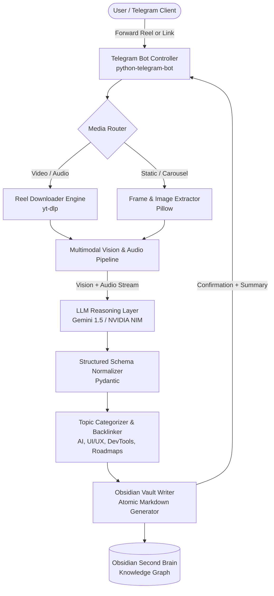

<div align="center">

# 🧠 Instagram Second Brain Agent
### Autonomous Multimodal Knowledge Extraction, Synthesis & Obsidian Vault Pipeline

[](https://python.org)
[](https://ai.google.dev)
[](https://build.nvidia.com)
[](https://core.telegram.org/bots)
[](https://obsidian.md)
[](LICENSE)

*An end-to-end intelligent agent pipeline designed to capture, transcribe, synthesize, and categorize technical knowledge from Instagram reels, carousels, and DMs directly into an atomic Obsidian Second Brain vault.*

</div>

---

## ⚡ Overview

High-value technical content shared on social media (system design architectures, developer roadmaps, UI/UX breakdowns, AI frameworks) often disappears into saved bookmarks. 

**Instagram Second Brain Agent** bridges the gap between passive consumption and active knowledge management. Forward any reel, post, or link to your private Telegram bot, and the agent orchestrates automated media retrieval, multimodal LLM vision/audio analysis, structured classification, and clean Obsidian markdown compilation with zero manual friction.

---

## 🏗️ System Architecture



---

## ✨ Key Capabilities

- **Multimodal Video & Audio Understanding**: Analyzes speech, on-screen text, and code snippets from reels using Gemini 1.5 and NVIDIA NIM inference.
- **Automated Knowledge Synthesis**: Converts chaotic video transcripts into concise, bulleted atomic notes with actionable takeaways.
- **Intelligent Category Routing**: Automatically classifies content into tailored knowledge hubs:
  - `UI-UX & Design`
  - `AI & Agent Frameworks`
  - `Internships & Opportunities`
  - `Hackathons & Contests`
  - `Roadmaps & Learning`
  - `Dev Tools & Utilities`
- **Obsidian Graph Compatibility**: Formats markdown notes with standard YAML frontmatter, tags, callouts, and internal wikilinks (`[[topic]]`).
- **Telegram Bot Bridge**: Authenticated personal pairing so only your authorized Telegram account can trigger extractions.

---

## 🛡️ Security & Zero-Trust Secret Isolation

This repository enforces strict security protocols:
- Real API tokens and credentials (`.env`, `token.json`, session files) are **never** committed or tracked.
- All sensitive variables are loaded exclusively from a local `.env` file via `python-dotenv`.
- A sanitized `.env.example` template is provided below for environment setup.

---

## 🚀 Getting Started

### 1. Clone the Repository
```bash
git clone https://github.com/Chinmay-sonar/instagram-second-brain-agent.git
cd instagram-second-brain-agent
```

### 2. Set Up Virtual Environment
```bash
python -m venv .venv
# On Windows:
.venv\Scripts\activate
# On macOS/Linux:
source .venv/bin/activate
```

### 3. Install Dependencies
```bash
pip install -r requirements.txt
```

### 4. Configure Environment Variables
Copy `.env.example` to `.env`:
```bash
cp .env.example .env
```
Edit `.env` and supply your API keys:
```env
# 1. Telegram Bot Credentials (from @BotFather)
TELEGRAM_BOT_TOKEN="your_telegram_bot_token_here"
TELEGRAM_ALLOWED_USER_ID="your_telegram_chat_id_here"

# 2. Obsidian Storage
OBSIDIAN_VAULT_PATH="C:/path/to/your/Obsidian/Vault"

# 3. AI Brain API Keys
GEMINI_API_KEY="your_gemini_api_key_here"
NVIDIA_API_KEY="your_nvidia_api_key_here"
```

### 5. Launch the Agent
```bash
python main.py
```

Send `/start` to your Telegram bot to pair your account. Any forwarded Instagram reel link will be processed and filed into your Obsidian vault automatically.

---

## 📂 Project Structure

```
instagram-second-brain-agent/
├── src/
│   ├── ai_extractor.py          # Multimodal LLM synthesis (Gemini/NVIDIA)
│   ├── config.py                # Environment configuration & category schemas
│   ├── instagram_commenter.py   # Automated comment listener
│   ├── instagram_dm_watcher.py  # Direct message processing loop
│   ├── link_resolver.py         # URL expander & canonicalizer
│   ├── obsidian_writer.py       # Atomic markdown vault generator
│   ├── reel_downloader.py       # yt-dlp media downloader
│   ├── telegram_bot.py          # Telegram bot handlers & dispatchers
│   └── web_extractor.py         # Web page & metadata extractor
├── The Extractor/               # Obsidian vault template & starter hubs
├── .env.example                 # Sanitized configuration template
├── .gitignore                   # Multi-tier secret isolation rules
├── main.py                      # Application entrypoint
└── requirements.txt             # Python dependencies
```

---

## 📜 License
Distributed under the MIT License. Built with ❤️ by [Chinmay Sonar](https://github.com/Chinmay-sonar).
